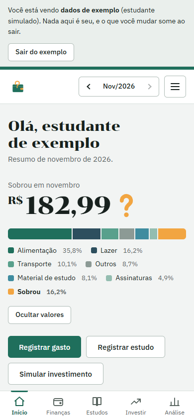
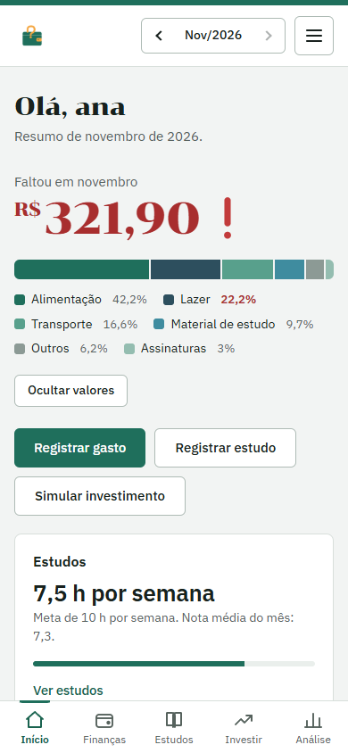
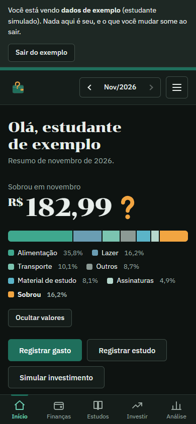
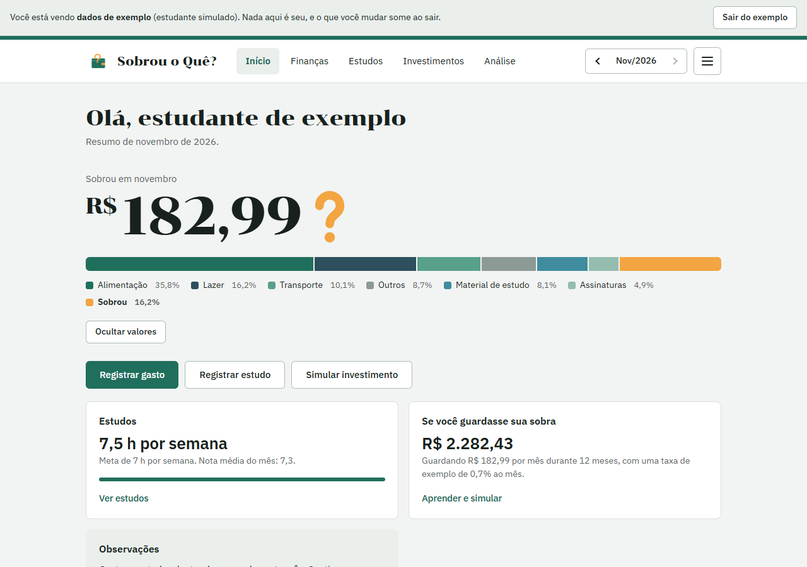
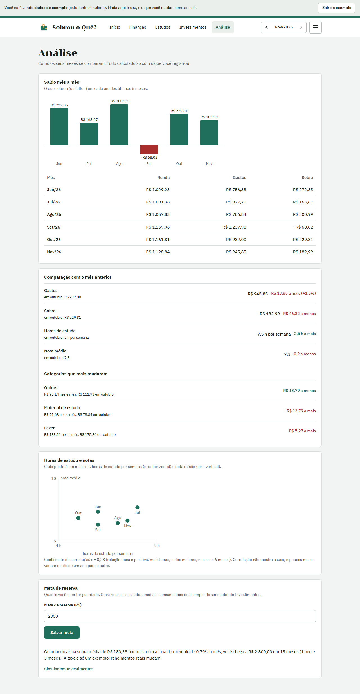
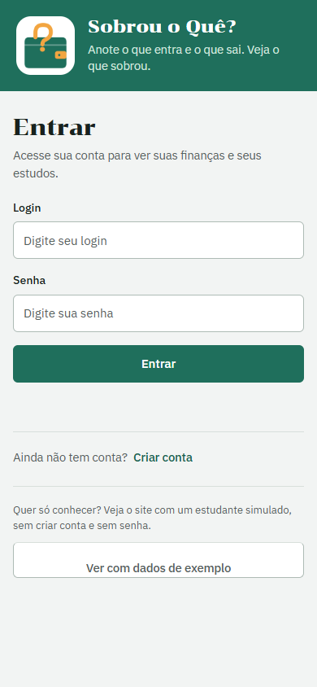
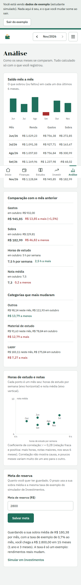

# Sobrou o Quê?

[](https://github.com/miguel-neri17/Sobrou-o-que/actions/workflows/ci.yml)
[](LICENSE)

**Demonstração:** https://miguel-neri17.github.io/Sobrou-o-que/ (na tela de entrada, use **Ver com dados de exemplo**)

> **In English:** a personal dashboard for students to track monthly income and spending, study hours and grades, and to simulate savings. It is a static site (plain HTML, CSS and JavaScript, no build step, no server) that keeps each user's data in the browser. The home screen answers the question in the name — *what's left over?* — with the amount that remained, or what was missing when spending passed income. It also imports bank statements (CSV), repeats fixed expenses, tracks a budget per category, compares months, and ships with a simulated student so anyone can try it without typing anything. Passwords are hashed (PBKDF2), JSON backup/import is validated, the layout is mobile-first with dark mode, and the tests run in jsdom and in a real browser.

Painel pessoal para estudantes: anote o que **entra e sai**, as **horas de estudo** e as **notas**, e veja de relance **o que sobrou** no mês.

<p align="center">
  
  
  
</p>

## Como experimentar

- **Sem instalar nada:** abra a [demonstração](https://miguel-neri17.github.io/Sobrou-o-que/) e clique em **Ver com dados de exemplo**. Você entra, sem senha, como um estudante simulado com 6 meses de dados. O que você mudar nele some ao sair.
- **No seu computador:** baixe o repositório e abra o `index.html` com duplo clique. Não precisa de servidor nem de instalação.

## O que o app faz

- **Início:** o valor que sobrou no mês é o protagonista. Se os gastos passam da renda, vira "Faltou…" em vermelho. Abaixo, a **barra da renda** (um trecho por categoria e um laranja para o que sobrou) e observações, como "o orçamento de Lazer passou em R$ X".
- **Finanças:**
  - renda do mês e gastos por categoria (adicionar, **editar** e **remover**);
  - **importar extrato do banco em CSV**, com uma tela de revisão antes de salvar: detecta separador, acentos, valores (`R$ 1.234,56`, `-12,50`, `(45,00)`) e datas, avisa o que é duplicado ou inválido, e reimportar o mesmo extrato não duplica nada;
  - **gastos fixos**: marque "Repetir todo mês" ao registrar um gasto e lance todos de uma vez em cada mês, sem digitar de novo;
  - **orçamento por categoria**: um limite mensal por categoria, com aviso ao chegar perto (80%) e ao passar.
- **Estudos:** horas por semana e por dia da semana, com **meta semanal** em linha tracejada, e notas por matéria com média automática.
- **Investimentos:** simulador de aportes mensais (juros compostos) e quatro textos curtos de educação financeira. A taxa é só um exemplo para estudar.
- **Análise:** saldo mês a mês (gráfico e tabela), comparação com o mês anterior (em palavras: "a mais", "a menos"), horas de estudo × nota com os seus meses, e **meta de reserva**: em quantos meses você chega nela com a sua sobra média.
- **Dados:** **exportar e importar** tudo em um arquivo `.json`, sem senha dentro.
- **Contas:** cada pessoa tem seus próprios dados no navegador, protegidos por login.
- **Interface:** abas embaixo no celular, links no topo no computador, modo claro e escuro automáticos.

## Capturas

| Início no computador | Análise no computador | Entrada, com o botão de exemplo |
|---|---|---|
|  |  |  |

<details>
<summary>Análise no celular</summary>



</details>

## Dados simulados

A pasta [`dados/`](dados/) tem bases **fictícias** (150 estudantes, 6 meses) para o projeto de análise: finanças, estudos, erros plantados de propósito e o gabarito. O formato de cada coluna e as premissas estão no [dicionário de dados](dados/DICIONARIO.md). Nenhuma pessoa real aparece nelas.

```bash
python dados/gerar_bases.py   # regenera as bases (dados/bases, dados/esperado e dados/gabarito_erros.csv)
python dados/gerar_demo.py    # regenera js/demo.js, o estudante do botão "Ver com dados de exemplo"
```

O estudante de exemplo é escolhido por regra a partir de `dados/esperado/` (as bases já tratadas) e convertido para o formato do app. O `js/demo.js` é um arquivo gerado, e um teste falha se ele ficar diferente do que o conversor produz.

## Testes

Precisa de Node 18 ou mais novo e, para os dados, Python 3.10 ou mais novo (só a biblioteca padrão). Para a bateria no navegador real, um Edge, Chrome ou Chromium instalado.

```bash
npm ci
npm run test:all
```

| Comando | O que roda |
|---|---|
| `npm test` | Fluxos completos em navegador simulado (jsdom): contas, gastos, importação e exportação, migração de formatos, extrato CSV, gastos fixos, orçamento, análise e conta de exemplo |
| `npm run test:csv` | Leitor de extrato: separadores, aspas, valores, datas e duplicados |
| `npm run test:calc` | Contas da aba Análise: saldo por mês, comparação, horas × nota e prazo da meta |
| `npm run test:ui` | Layout, abas, menu, animação e rolagem lateral em um navegador real |
| `npm run test:dados` | Gerador das bases simuladas e conversor do estudante de exemplo |

O [GitHub Actions](.github/workflows/ci.yml) roda tudo a cada push e a cada pull request. Para refazer as capturas de tela: `npm run screenshots -- <rotulo> <largura> <altura> [light|dark] [cheio|negativo|vazio|exemplo]`.

## Estrutura

```
index.html            todas as telas (abas por #hash) e a ordem dos scripts
style.css             estilos, com modo claro e escuro
js/                   um arquivo por responsabilidade, carregados como scripts comuns
  util.js state.js    funções pequenas; constantes e estado da tela
  storage.js calc.js  validação e armazenamento; contas (sem mexer na tela)
  auth.js             login, cadastro e senhas com hash
  render.js forms.js  desenho das telas; formulários e botões
  backup.js           exportar e importar JSON
  csv.js extrato.js   leitor de extrato; tela de revisão da importação
  demo.js exemplo.js  estudante simulado (gerado); botão "Ver com dados de exemplo"
  nav.js main.js      rotas e menu; inicialização
dados/                bases simuladas, dicionário de dados e geradores (Python)
tests/                testes em Node (jsdom) e em Python
scripts/              capturas de tela e busca do navegador para os testes
docs/screenshots/     imagens do README
```

## Decisões técnicas

- **Sem servidor e sem build.** É HTML, CSS e JavaScript puros, e abre com duplo clique. O JS está em arquivos por responsabilidade, carregados como **scripts comuns** e não como módulos ES, porque o Chrome bloqueia módulos quando a página é aberta por `file://`. Os arquivos se enxergam pelo objeto `Sobrou`, e a ordem dos `<script>` importa. Pelo mesmo motivo o estudante de exemplo vira um `.js` gerado, e não um CSV lido na hora.
- **Senhas com hash.** PBKDF2-SHA-256, sal aleatório e 600.000 iterações, usando a Web Crypto API. Contas criadas com um custo menor são refeitas sozinhas no próximo login correto, e contas antigas que guardavam a senha em texto são convertidas no primeiro acesso.
- **Nada de fora entra sem validação.** Tudo que vem do `localStorage` ou de um arquivo importado passa por validação de tipos, limites, categorias conhecidas e `id`s com caracteres seguros (eles vão para atributos HTML). Textos digitados passam por `esc()` antes de virar HTML, e os gráficos em SVG só recebem números e rótulos fixos.
- **Gravar é tudo ou nada.** Importar arquivo, importar extrato, lançar gastos fixos, salvar orçamento e salvar a meta restauram o estado anterior se o navegador não deixar gravar.
- **Formatos antigos continuam funcionando.** O mês é guardado como `AAAA-MM`, mas `AAAA-M` ainda é lido; a categoria `contas` virou `assinaturas` e é convertida ao carregar. Os campos novos do arquivo exportado (gastos fixos, orçamento, meta) são opcionais, e um arquivo antigo, sem eles, mantém o que já existe.
- **A conta de exemplo não toca em dados reais.** O cadastro só aceita logins com letras minúsculas, números, ponto, hífen e sublinhado, então ninguém tem uma conta chamada `@exemplo`, e o formulário de login não entra nela, só o botão.
- **Gráficos sem biblioteca.** Saldo por mês e horas × nota são SVG montado no código, cada um com uma tabela ou texto equivalente para leitor de tela. O coeficiente de correlação só aparece a partir de 4 meses, sempre com o aviso de que correlação não mostra causa.

## Avisos

- Os seus registros ficam **só neste navegador**. Limpar os dados do navegador apaga tudo, então exporte um arquivo de vez em quando.
- O login só separa os dados de cada pessoa **neste navegador**. Quem tiver acesso ao aparelho ainda consegue ler o `localStorage`, então ele **não protege** contra isso. Não use uma senha que você usa em outros lugares.
- O simulador e a meta de reserva usam uma taxa de **exemplo** para estudar. Rendimentos reais mudam e podem ser negativos, e nada aqui é recomendação financeira.
- Os dados de `dados/` e o estudante de exemplo são **fictícios**.

## Licença

[MIT](LICENSE).
