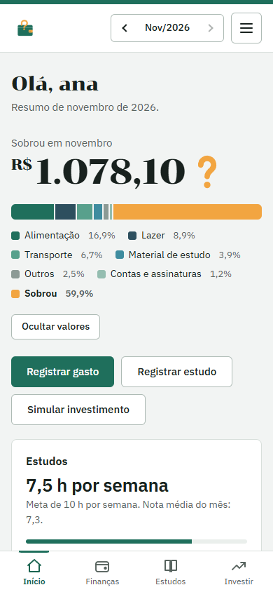
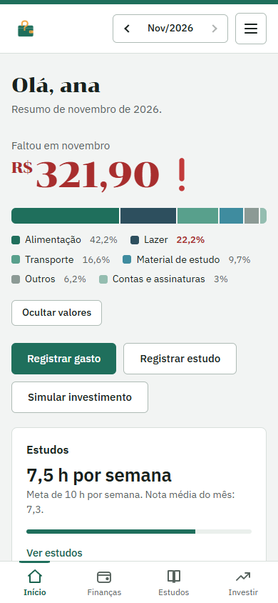
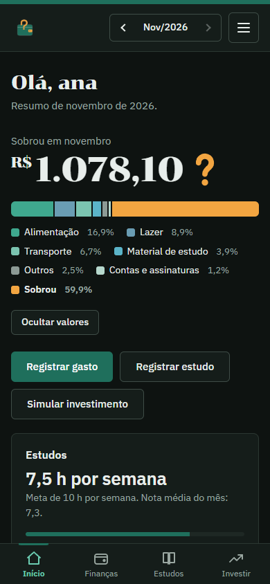
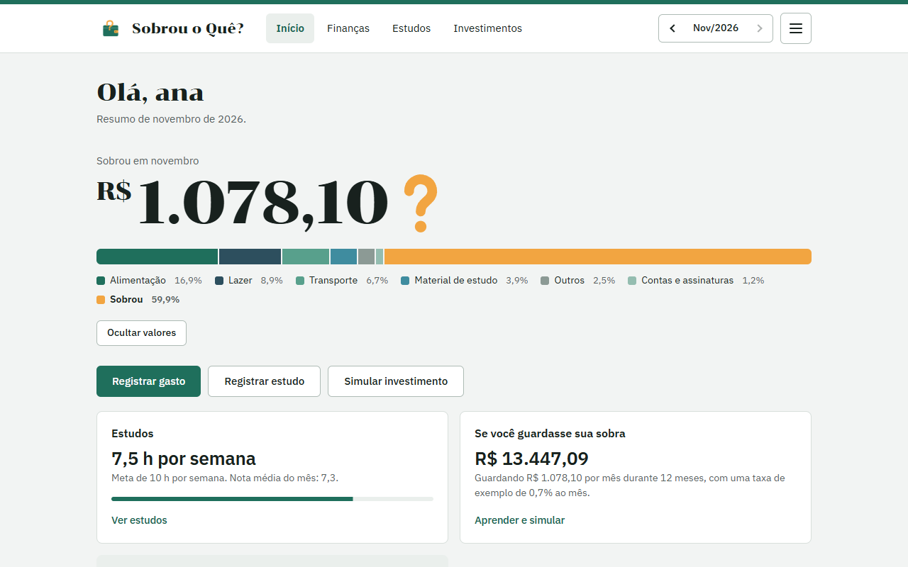
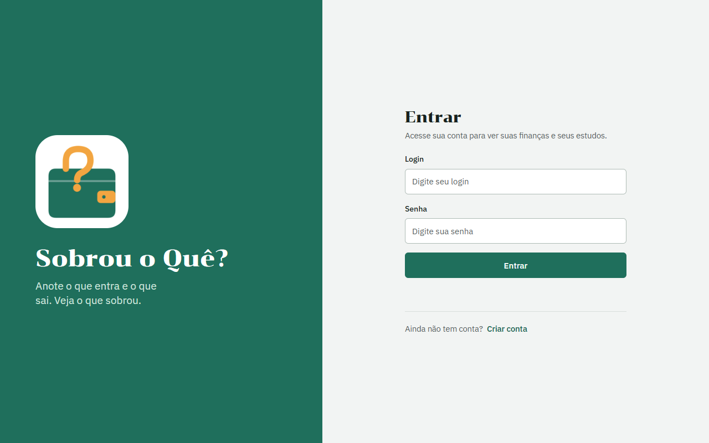
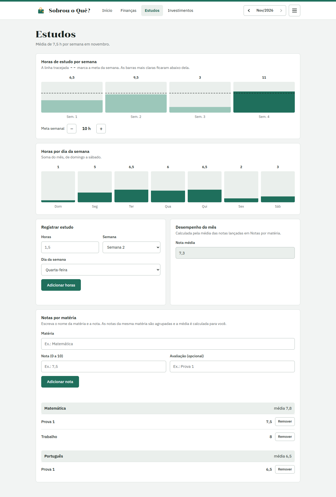
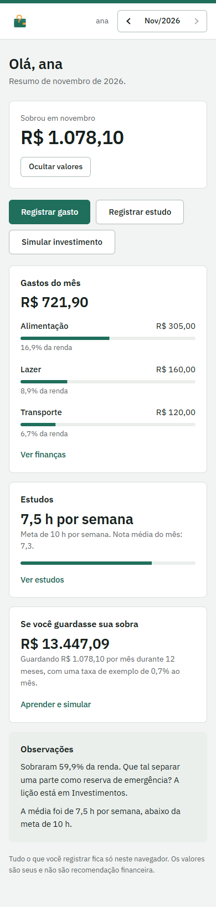

# Sobrou o Quê?

[](https://github.com/SEU_USUARIO/sobrou-o-que/actions/workflows/ci.yml)
[](LICENSE)

**Demonstração:** https://SEU_USUARIO.github.io/sobrou-o-que/

> **In English:** a personal dashboard for students to track monthly income and spending, study hours and grades, and to simulate savings. It is a static site (plain HTML, CSS and JavaScript, no build step, no server) that keeps each user's data in the browser. The home screen answers the question in the name — *what's left over?* — with the amount that remained, or what was missing when spending passed income. It has password hashing (PBKDF2), validated JSON backup/import, a mobile-first layout, dark mode, and automated tests in jsdom and in a real browser.

Painel pessoal para estudantes: anote o que **entra e sai**, as **horas de estudo** e as **notas**, e veja de relance **o que sobrou** no mês.

<p align="center">
  
  
  
</p>

## O que o app faz

- **Início:** o valor que sobrou no mês é o protagonista. Se os gastos passam da renda, vira "Faltou…" em vermelho. Abaixo, a **barra da renda**: um trecho por categoria e um trecho laranja para o que sobrou.
- **Finanças:** renda do mês, gastos por categoria (adicionar, **editar** e **remover**) e lançamentos em lista.
- **Estudos:** horas por semana e por dia da semana, com **meta semanal** marcada em linha tracejada, e notas por matéria com média automática.
- **Investimentos:** simulador de aportes mensais (juros compostos) e quatro textos curtos de educação financeira.
- **Dados:** **exportar e importar** tudo em um arquivo `.json`, sem senha dentro.
- **Contas:** cada pessoa tem seus próprios dados no navegador, protegidos por login.
- **Interface:** abas na parte de baixo no celular, links no topo no computador, modo claro e escuro automáticos.

## Capturas

| Computador | Entrada | Estudos |
|---|---|---|
|  |  |  |

<details>
<summary>Como era antes do redesenho (início no celular)</summary>



</details>

## Decisões técnicas

- **Sem servidor e sem build.** É HTML, CSS e JavaScript puros, e abre com duplo clique. O JS está dividido em arquivos por responsabilidade (`js/`), carregados como **scripts comuns** e não como módulos ES, porque o Chrome bloqueia módulos quando a página é aberta por `file://`. Os arquivos se enxergam pelo objeto `Sobrou`, e a ordem dos `<script>` importa.
- **Senhas com hash.** PBKDF2-SHA-256, sal aleatório e 600.000 iterações, usando a Web Crypto API. Contas criadas com um custo menor são refeitas sozinhas no próximo login correto. Contas antigas, que guardavam a senha em texto, são convertidas no primeiro acesso.
- **Nada de fora entra sem validação.** Tudo que vem do `localStorage` ou de um arquivo importado passa por `cleanMonth`: tipos, limites, categorias conhecidas e `id`s com caracteres seguros (eles vão para atributos HTML). Textos digitados passam por `esc()` antes de virar HTML.
- **Importação à prova de falha.** Valida o arquivo, mostra quantos meses entram, pede confirmação e, se o navegador não conseguir gravar (armazenamento cheio), restaura os dados anteriores em vez de fingir que deu certo.
- **Acessibilidade.** Foco visível e devolvido ao fechar o menu, `aria-current` na seção ativa, `aria-expanded`, rótulos em todos os botões, texto alternativo na barra da renda, alvos de toque de pelo menos 44 px e `prefers-reduced-motion` respeitado (a única animação por conta própria é a contagem do valor, uma vez por entrada).
- **Design com regra.** Verde para estrutura e gastos; **laranja só para "o que sobrou"**. A meta de estudo é uma marca tracejada, e não só uma cor.

## Estrutura

```
index.html        telas e marcação
style.css         estilos (tema claro/escuro por variáveis)
js/
  util.js         funções pequenas sem estado
  state.js        categorias, meses exibidos e estado da tela
  storage.js      modelo de dados, validação e persistência
  calc.js         contas (sobra, categorias, médias, juros)
  auth.js         login, cadastro e hash de senha
  render.js       desenho das telas
  forms.js        formulários e botões
  backup.js       exportar e importar
  nav.js          menu lateral e rotas
  main.js         liga tudo
tests/            testes automatizados
scripts/          utilitários (capturas de tela, detecção de navegador)
```

## Como rodar

Não precisa instalar nada: abra o `index.html` no navegador. Para servir por HTTP, qualquer servidor estático serve, por exemplo `npx serve .`.

## Testes

Precisa de Node 18 ou mais novo.

```bash
npm install
npm test          # 59 verificações em navegador simulado (jsdom): contas, gastos, importação e exportação
npm run test:ui   # 39 verificações em navegador real (Edge, Chrome ou Chromium): layout, abas, menu, animação, rolagem lateral
```

O segundo comando usa um navegador já instalado. Se ele não achar o seu, aponte o caminho com `BROWSER_PATH`:

```bash
BROWSER_PATH="C:/caminho/para/chrome.exe" npm run test:ui
```

Os mesmos testes rodam no GitHub Actions a cada push.

## Limitações assumidas

- **O login só separa os perfis neste navegador.** Não há servidor, então quem abrir as ferramentas do navegador consegue ler o `localStorage`. O hash evita guardar a senha em texto, mas isto **não é proteção contra alguém com acesso ao aparelho**.
- **Os dados ficam presos ao navegador.** Trocar de aparelho exige exportar e importar o arquivo.
- **O site mostra os 6 últimos meses.**
- A fonte de destaque (Chonburi) vem do Google Fonts. Sem internet, cai para uma serifa do sistema.
- Testado em Edge e Chrome. Não foi testado em Safari nem Firefox.
- Os valores do simulador de investimentos são só um exemplo educativo e não são recomendação financeira.

## Próximos passos

- Conta real e sincronização entre aparelhos (Supabase ou Firebase).
- Metas de economia e orçamento por categoria.
- Gastos recorrentes e categorias editáveis.
- TypeScript, Vite, ESLint e instalação como app (PWA).

## Licença

[MIT](LICENSE)
